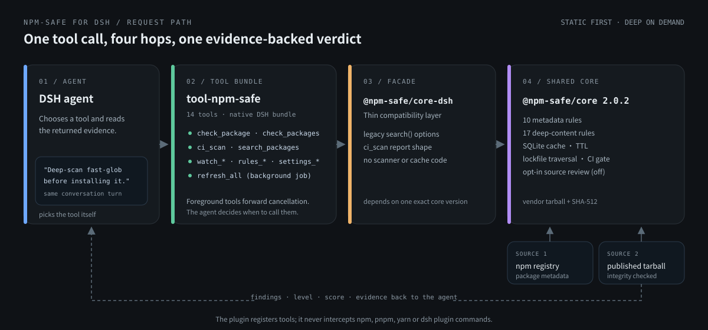
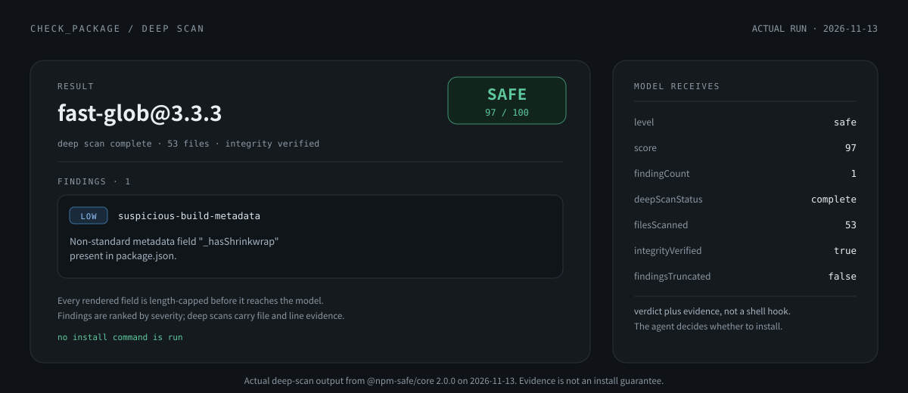

<div align="center">

# npm-safe for DeepSeek Harness

**Give AI agents evidence before they choose an npm package.**

[](https://www.npmjs.com/package/@npm-safe/dsh-tool-npm-safe)
[](https://www.npmjs.com/package/@npm-safe/dsh-tool-npm-safe)
[](https://github.com/nisconder/npm-safe-forDSH/actions/workflows/ci.yml)
[](LICENSE)
[](https://nodejs.org)
[](https://github.com/topics/dsh-plugin)
[](https://www.dsh.so/artifact/npm-safe-fordsh/?ref=badge)

**14 agent tools · 27 security checks · integrity-verified deep scans · local SQLite cache**

[Install](#30-second-install) · [See what it catches](#what-it-catches) · [Tool catalog](#14-agent-tools) · [中文](README_zh.md)

</div>

`npm-safe-forDSH` provides supply-chain security checking tools for
[DeepSeek Harness](https://github.com/deepseek-ai/deepseek-harness). It lets an
agent inspect npm package metadata and published tarballs **before** an install,
then returns evidence, a risk level, and an explainable score inside the same
conversation.

The plugin registers tools that an agent can choose to call. It does not
intercept shell commands or automatically block every `npm`, `pnpm`, `yarn`,
or DSH plugin installation. Configure your agent workflow to require a check
of the exact version before installing; enforce a mandatory install policy
in your host or CI separately. A `ci_scan` failure is a tool result that its
caller must act on.



<sub>The agent picks a tool; the facade forwards to the pinned core; evidence comes back in the same turn. The plugin never intercepts install commands.</sub>

> If this makes your agent workflow safer, please **Star the repository**. It
> helps other DSH users find an independent security tool.

## 30-second install

```bash
dsh plugin --profile tui add @npm-safe/dsh-tool-npm-safe --allow-build=better-sqlite3
dsh --profile tui
```

Restart a running profile after installation. Then ask:

```text
Deep-scan fast-glob before installing it. Explain every finding.
```

For a quick metadata-only check:

```text
Use check_package to check lodash.
```

The plugin is declared as a native DSH bundle, so the official `dsh plugin`
command installs the package and activates its `cordis.patch.yml` layer.
`--allow-build=better-sqlite3` grants build permission only to the SQLite
driver used for the local cache; pnpm continues to block install scripts from
other dependencies. Your selected DSH model provider must already be
configured; a DeepSeek API key is only required when DeepSeek is the selected
provider.

## What it catches

| Signal | Metadata scan | Deep scan |
|---|:---:|:---:|
| Suspicious lifecycle scripts and install hooks | ✅ | ✅ |
| Typosquatting, abandoned packages, risky maintainers | ✅ | ✅ |
| Non-standard registries and remote binaries | ✅ | ✅ |
| Tarball integrity mismatch and unsafe archive paths | — | ✅ |
| Obfuscated code, embedded secrets, shell/network execution | — | ✅ |
| Native binaries, WebAssembly, oversized or truncated content | — | ✅ |

Metadata scans are fast and remain the default. Set `deep: true` to download
the same-origin published tarball, verify npm integrity metadata, and inspect
bounded source content entirely in memory.

```text
package: fast-glob@3.3.3
level: safe
score: 97/100
integrity: verified
files scanned: 53
findings: 1 low, 0 medium, 0 high, 0 critical
```



<sub>Actual deep-scan output from the pinned core on 2026-11-13. Findings and scores are evidence, not an install guarantee.</sub>

## Why use it in an agent

| Typical agent workflow | With npm-safe-forDSH |
|---|---|
| Installs first and audits later | Checks before the install decision |
| Trusts package names and download counts | Evaluates maintainers, scripts, provenance signals, and content |
| Returns a pass/fail with little context | Returns findings, evidence, severity, score, and recommendations |
| Repeats registry traffic | Uses a local SQLite cache and rate limiting |
| Checks one package manually | Supports batch checks, watchlists, refresh jobs, and CI gates |

## 14 agent tools

| Tool | Purpose |
|---|---|
| `check_package` | Check one package, with optional `version`, `forceRefresh`, and `deep` |
| `check_packages` | Rate-limited batch checking |
| `search_packages` | Search the npm registry |
| `watch_add` / `watch_remove` / `watch_list` | Manage a persistent watchlist |
| `rules_list` / `rule_enable` / `rule_disable` | Inspect and toggle rules |
| `rule_set_severity` | Override a rule severity |
| `settings_get` / `settings_set` | Read or update engine settings |
| `ci_scan` | Scan a project's dependencies as a security gate |
| `refresh_all` | Refresh the watchlist as a background DSH job |

## Security model

- Core detection is deterministic and local-first; no package source is sent
  to an external LLM by default.
- Deep scans reject cross-origin tarballs and enforce archive size, file count,
  decompression, path, and scanned-text limits.
- Findings are evidence, not a guarantee that a package is safe. Review high
  impact packages and pin versions in production.
- See the complete [scanner rules](packages/core/SCANNER_RULES.md) and
  [security policy](SECURITY.md).

## Use the engine directly

```bash
pnpm add @npm-safe/core-dsh
```

```ts
import { NpmSafeEngine } from "@npm-safe/core-dsh";

const engine = new NpmSafeEngine();
const report = await engine.checkPackage("lodash", { version: "4.17.21", deep: true });
console.log(report.latestVersion, report.security.overallLevel, report.security.overallScore);
await engine.close();
```

## Develop from source

Requires Node.js 24.9+ and Corepack.

```bash
git clone https://github.com/nisconder/npm-safe-forDSH.git
cd npm-safe-forDSH
corepack enable
corepack prepare pnpm@11.7.0 --activate
pnpm install
pnpm run build
pnpm run typecheck
pnpm run test
```

The repository pins a release tarball of `@npm-safe/core@2.0.1` under `vendor/`
through a workspace override. The scanner source is maintained only in
[`nisconder/npm-safe`](https://github.com/nisconder/npm-safe). `packages/core`
is a small compatibility facade, with no copied scanner, database, or registry
implementation. See [updating the shared core](vendor/README.md) for the
reproducible `--core-tarball` workflow and the release order.

Live registry smoke tests:

```bash
node scripts/smoke.mjs lodash
node scripts/smoke-facade.mjs
```

The workspace contains [`@npm-safe/core-dsh`](packages/core) and the
[`@npm-safe/dsh-tool-npm-safe`](packages/tool-npm-safe) bundle. DSH peer
packages are aligned to the `0.2.2-rc.3` family, and the bundle declares
`engines.dsh` as `>=0.2.2-rc.3 <0.3.0`; upgrades must keep the peers and that
range aligned while DeepSeek Harness is in developer preview.

## Documentation

- [Plugin package and examples](packages/tool-npm-safe/README.md)
- [Engine API](packages/core/API.md)
- [Architecture](packages/core/ARCHITECTURE.md)
- [Scanner rules](packages/core/SCANNER_RULES.md)
- [Contributing](CONTRIBUTING.md)

This project depends on the shared engine from
[`nisconder/npm-safe`](https://github.com/nisconder/npm-safe) for DeepSeek
Harness. It is an independent community project and is not affiliated with or
endorsed by DeepSeek.

## License

[Apache-2.0](LICENSE) — Copyright 2026 Nisconder, InfiniteScope, Escap1ng, StoryBegins.
