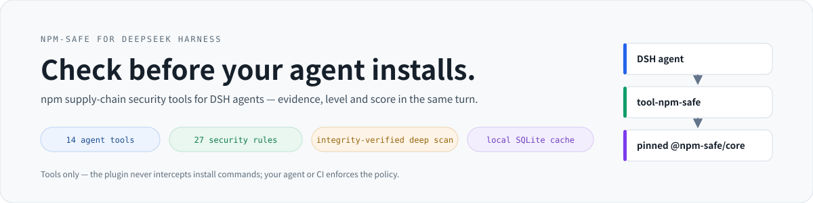
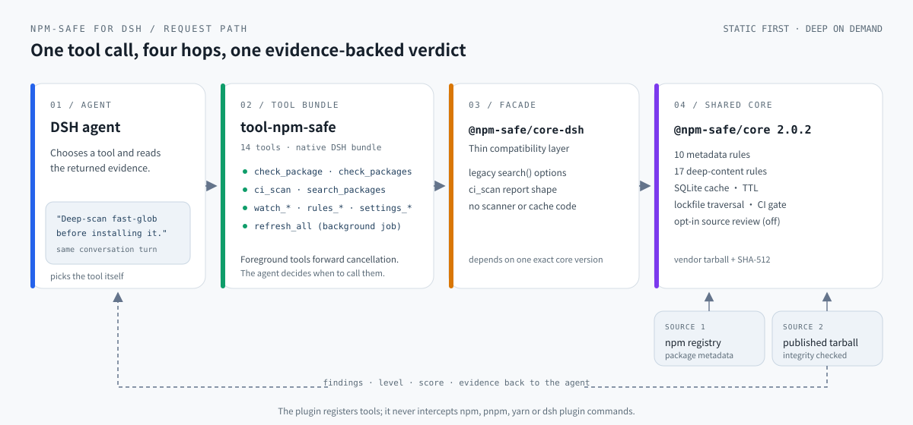
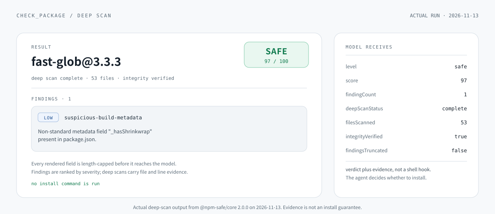

<div align="center">

<picture>
  <source media="(prefers-color-scheme: dark)" srcset="docs/assets/dsh-banner-dark.svg">
  
</picture>

# npm-safe for DeepSeek Harness

**Check before your agent installs.** npm supply-chain security tools for
[DeepSeek Harness](https://github.com/deepseek-ai/deepseek-harness) agents.

[](https://www.npmjs.com/package/@npm-safe/dsh-tool-npm-safe)
[](https://www.npmjs.com/package/@npm-safe/dsh-tool-npm-safe)
[](https://github.com/nisconder/npm-safe-forDSH/actions/workflows/ci.yml)
[](LICENSE)
[](https://nodejs.org)
[](https://github.com/topics/dsh-plugin)
[](https://www.dsh.so/artifact/npm-safe-fordsh/?ref=badge)

[Install](#30-second-install) · [Features](#features) · [Security model](#security-model) · [Tools](#14-agent-tools) · [Docs](#documentation) · [中文](README_zh.md)

</div>

---

`npm-safe-forDSH` lets an agent inspect npm package metadata and published
tarballs **before** an install, then returns evidence, a risk level, and an
explainable 0–100 score inside the same conversation. Detection runs locally
through the pinned [`@npm-safe/core`](https://github.com/nisconder/npm-safe)
scanner — no account, no hosted backend, and no package source sent to an
external LLM by default.

The plugin registers tools that an agent can choose to call. It does not
intercept shell commands or automatically block every `npm`, `pnpm`, `yarn`,
or DSH plugin installation. Configure your agent workflow to require a check
of the exact version before installing; enforce a mandatory install policy
in your host or CI separately. A `ci_scan` failure is a tool result that its
caller must act on.

> The plugin pins **@npm-safe/core 2.0.2**: complete scans with High findings
> are at least `suspicious`, and optional LLM **source review** is available
> behind a separate, default-off switch. See the
> [shared-core workflow](vendor/README.md) for how the pinned release is
> updated and verified.

## Why npm-safe-forDSH?

`npm audit` finds published vulnerabilities in known dependency versions.
npm-safe-forDSH complements it by giving your agent **supply-chain attack
signals** before the install decision:

- **Local-first.** Static analysis and caching stay on your machine; no account or hosted backend.
- **Bounded and inert.** Deep scans parse tarballs in memory within strict byte budgets — never extracted, never executed.
- **Evidence, not verdicts.** Findings carry severity, rule, file/line location, and recommendations the agent can explain.
- **Explainable.** 10 metadata rules + 17 deep-scan rules, all configurable through tools and persisted settings.

| Use case | Ask the agent | What you get |
|---|---|---|
| Check before choosing | `Use check_package to check lodash` | Findings, risk level, security score |
| Verify published contents | `Deep-scan fast-glob before installing it` | Integrity-verified tarball inspection |
| Guard a project | `Use ci_scan to scan dependencies` | Dependency gate with failed packages listed |
| Compare options | `Use check_packages for lodash, express, axios` | Ranked evidence per package |
| Track dependencies | `Add axios to the watchlist` | Persistent watchlist + background refresh |

<picture>
  <source media="(prefers-color-scheme: dark)" srcset="docs/assets/dsh-architecture.svg">
  
</picture>

<sub>The agent picks a tool; the facade forwards to the pinned core; evidence comes back in the same turn. The plugin never intercepts install commands.</sub>

> If this makes your agent workflow safer, please **Star the repository**. It
> helps other DSH users find an independent security tool.

## 30-second install

Requires Node.js 24.9+ and a DSH profile with a configured model provider.

```bash
dsh plugin --profile tui add @npm-safe/dsh-tool-npm-safe --allow-build=better-sqlite3
dsh --profile tui
```

Restart a running profile after installation. Then ask:

```text
Deep-scan fast-glob before installing it. Explain every finding.
```

For a quick metadata-only check:

```text
Use check_package to check lodash.
```

The plugin is declared as a native DSH bundle, so the official `dsh plugin`
command installs the package and activates its `cordis.patch.yml` layer.
`--allow-build=better-sqlite3` grants build permission only to the SQLite
driver used for the local cache; pnpm continues to block install scripts from
other dependencies. A DeepSeek API key is only required when DeepSeek is the
selected provider.

## Features

### Deep scan

Metadata scans are fast and remain the default. Set `deep: true` to download
the selected version's tarball from the configured registry, verify npm
integrity metadata when present, and inspect bounded source content entirely
in memory. High-confidence findings carry file paths and line numbers. The
scanner never extracts package files or executes package code.

| Signal | Metadata scan | Deep scan |
|---|:---:|:---:|
| Suspicious lifecycle scripts and install hooks | ✅ | ✅ |
| Typosquatting, abandoned packages, risky maintainers | ✅ | ✅ |
| Non-standard registries and remote binaries | ✅ | ✅ |
| Tarball integrity mismatch and unsafe archive paths | — | ✅ |
| Obfuscated code, embedded secrets, shell/network execution | — | ✅ |
| Native binaries, WebAssembly, oversized or truncated content | — | ✅ |

| Limit | Value |
|---|---|
| Compressed archive | 20 MiB |
| Unpacked archive | 50 MiB |
| Archive entries | 5,000 |
| Per text file | 4 MiB |
| Total text inspected | 8 MiB |

Tarball URLs and redirects must remain on the configured registry origin.
Reaching a limit produces a visible partial result instead of a silent pass;
an unavailable deep scan is reported as such, never as `safe`.

```text
package: fast-glob@3.3.3
level: safe
score: 97/100
integrity: verified
files scanned: 53
findings: 1 low, 0 medium, 0 high, 0 critical
```

<picture>
  <source media="(prefers-color-scheme: dark)" srcset="docs/assets/dsh-scan-output.svg">
  
</picture>

<sub>Actual deep-scan output from the pinned core on 2026-11-13. Findings and scores are evidence, not an install guarantee.</sub>

### 14 agent tools

| Tool | Purpose | Execution |
|---|---|---|
| `check_package` | Check one package; optional `version`, `forceRefresh`, `deep`; returns ranked findings with rule and location | Foreground (signal-forwarded) |
| `check_packages` | Rate-limited batch checking; optional `deep` | Foreground (rate-limited) |
| `search_packages` | Keyword search of the npm registry | Foreground |
| `watch_add` / `watch_remove` / `watch_list` | Manage a persistent watchlist | Foreground |
| `rules_list` / `rule_enable` / `rule_disable` | Inspect and toggle rules (persisted) | Foreground |
| `rule_set_severity` | Override a rule severity (persisted) | Foreground |
| `settings_get` / `settings_set` | Read or update engine settings (persisted) | Foreground |
| `ci_scan` | Dependency gate scan in the agent's working directory | Foreground (signal-forwarded) |
| `refresh_all` | Refresh all watched packages | Background (`ctx.jobs.start`) |

Every rendered field is length-capped before it reaches the model — package
names, messages, paths, snippets, and recommendations are bounded so a single
package cannot exhaust the context window. Findings are ranked by severity;
foreground tools forward cancellation, and `refresh_all` runs as a DSH
background job with its own cancellation signal.

### CI gate

`ci_scan` scans the project in the agent's working directory and reports
failed packages with their findings:

```text
Use ci_scan to scan dependencies with failLevel suspicious and lockfile true
```

| Parameter | Effect |
|---|---|
| `failLevel` | Level that fails the gate: `safe`, `suspicious`, `dangerous`, `unknown` (default `dangerous`) |
| `lockfile` | Scan every lockfile dependency, including transitives, at exact locked versions |
| `prod` | Skip devDependencies |
| `deep` | Download and inspect every published tarball |

Critical findings always block, even at a high numerical score. Unknown
packages and incomplete scans fail closed. The shared engine owns lockfile
traversal and failure policy; the facade only formats the report. A failed
scan is a tool result — your agent or CI must act on it.

### Rules and configuration

Ten metadata rules and seventeen deep-content rules detect install scripts,
obfuscation, typosquatting, secret exposure, unsafe archives, executable
content, process/network combinations, and more. Manage them from the
conversation:

```text
Use rules_list to show all rules
Use rule_disable to disable install-script
Use rule_set_severity to set typosquatting to critical
```

Overrides persist in `~/.npm-safe/rules.json` and invalidate cached
assessments under the shared scanner fingerprint. The shared core also loads
local rule plugins from `~/.npm-safe/rules/` at startup. Use `rules_list` (or
`engine.listRules()`) to inspect the exact effective rules in the pinned
release; the full rule reference lives in the
[upstream scanner](https://github.com/nisconder/npm-safe/blob/main/packages/core/SCANNER_RULES.md).

### Watchlist, batch, and refresh

`check_packages` checks multiple packages with the engine's token-bucket rate
limiter (5 tokens/s, 10 burst) to avoid registry throttling. Watched packages
persist in the local SQLite database; `refresh_all` re-checks them as a DSH
background job, so long refreshes never block the conversation.

### LLM source review

The shared engine's optional LLM analysis and **source review** (2.0) are
disabled by default; without an API key, static analysis continues normally.
When source review is enabled through the engine's saved configuration
(`~/.npm-safe/llm.json`, providers: OpenAI, Gemini, Anthropic), its findings
join the ranked evidence in `check_package`, `check_packages`, and `ci_scan`.

Model results can never clear static alerts or raise the static score. A
critical source-review finding fails the CI gate regardless of `failLevel`.
Only the configured provider receives the selected excerpts; latency and
model charges increase. See the
[upstream source-review documentation](https://github.com/nisconder/npm-safe/blob/main/docs/source-review.md)
for behavior and limits.

## Security model

npm-safe-forDSH is an early-warning heuristic, **not a safety certification**.
The default scan inspects registry metadata, the selected manifest, and
README; `deep: true` additionally verifies and heuristically inspects the
shipped tarball within strict resource limits.

| Level | Meaning |
|---|---|
| `safe` | Score 80–100, no High/Critical finding, complete scan |
| `suspicious` | Score 50–79, or any High finding on a complete scan |
| `dangerous` | Any Critical finding, or score < 50 |
| `unknown` | Incomplete scan without established danger |

Score = 100 minus severity weights (Critical 25 · High 15 · Medium 8 · Low 3).
Medium/Low findings may appear in a `safe` report; neither the score nor the
label is a probability or guarantee of runtime safety. False positives and
missed detections are possible. Review high-impact packages, pin versions in
production, and apply least-privilege controls to your agents.

- Core detection is deterministic and local-first; no package source is sent to an external LLM by default.
- Deep scans reject cross-origin tarballs and enforce archive size, file count, decompression, path, and scanned-text limits.
- See the [scanner rules](packages/core/SCANNER_RULES.md) and [security policy](SECURITY.md).

## Architecture

Four hops, one evidence-backed verdict. The plugin imports
`@npm-safe/core-dsh`, a thin subclass of the pinned `@npm-safe/core`; all
registry requests, scans, cache reads, rule configuration, rate limiting, and
refresh work execute in the shared package.

| Layer | Role |
|---|---|
| **DSH agent** | Chooses tools, reads evidence, decides whether to install. |
| **tool-npm-safe** | 14 tools, native DSH bundle, bounded output, cancellation forwarding. |
| **@npm-safe/core-dsh** | Thin facade: legacy search options and CI report shape only. |
| **@npm-safe/core 2.0.2** | Registry client, 27-rule scanner, scheduler, SQLite store. |

### Key design decisions

| Decision | Rationale |
|---|---|
| Pinned core tarball + SHA-512 | Exact bytes are tested before publish; scanner source is maintained only upstream. |
| Thin facade, no copied scanner | One source of truth for detection, cache validity, and failure policy. |
| Bounded tool output | Package-controlled text is length-capped before it reaches the model. |
| One shared level policy | Live scans, cached reports, and CI agree; LLM cannot raise the static score. |
| Tools, not shell hooks | The agent or host enforces install policy; the plugin never intercepts commands. |

[Full architecture →](packages/core/ARCHITECTURE.md)

## Configuration and data

| Path | Purpose |
|---|---|
| `./npm-safe.db` | SQLite (relative to the DSH host working directory): cache, watchlist, settings, check history |
| `~/.npm-safe/rules.json` | Rule enablement/severity overrides |
| `~/.npm-safe/rules/` | Local rule plugins loaded by the shared core |
| `~/.npm-safe/llm.json` | LLM provider configuration (source review off by default) |

Environment: `OPENAI_API_KEY` / `GEMINI_API_KEY` / `ANTHROPIC_API_KEY` for
optional LLM analysis. Metadata cache TTL is 1 hour; rule changes invalidate
cached reports.

## Use the engine directly

```bash
pnpm add @npm-safe/core-dsh
```

```ts
import { NpmSafeEngine } from "@npm-safe/core-dsh";

const engine = new NpmSafeEngine();
const report = await engine.checkPackage("lodash", { version: "4.17.21", deep: true });
console.log(report.latestVersion, report.security.overallLevel, report.security.overallScore);
await engine.close();
```

## Develop from source

Requires Node.js 24.9+ and Corepack.

```bash
git clone https://github.com/nisconder/npm-safe-forDSH.git
cd npm-safe-forDSH
corepack enable
corepack prepare pnpm@11.7.0 --activate
pnpm install
pnpm run build
pnpm run typecheck
pnpm run test
```

The repository pins a release tarball of `@npm-safe/core@2.0.2` under `vendor/`
through a workspace override. The scanner source is maintained only in
[`nisconder/npm-safe`](https://github.com/nisconder/npm-safe). `packages/core`
is a small compatibility facade, with no copied scanner, database, or registry
implementation. See [updating the shared core](vendor/README.md) for the
reproducible `--core-tarball` workflow and the release order.

Live registry smoke tests:

```bash
node scripts/smoke.mjs lodash
node scripts/smoke-facade.mjs
```

The workspace contains [`@npm-safe/core-dsh`](packages/core) and the
[`@npm-safe/dsh-tool-npm-safe`](packages/tool-npm-safe) bundle. DSH peer
packages are aligned to the `0.2.2-rc.3` family, and the bundle declares
`engines.dsh` as `>=0.2.2-rc.3 <0.3.0`; upgrades must keep the peers and that
range aligned while DeepSeek Harness is in developer preview.

## Documentation

| Topic | Link |
|---|---|
| Plugin package and examples | [packages/tool-npm-safe/README.md](packages/tool-npm-safe/README.md) |
| Engine API | [packages/core/API.md](packages/core/API.md) |
| Architecture | [packages/core/ARCHITECTURE.md](packages/core/ARCHITECTURE.md) |
| Scanner rules | [packages/core/SCANNER_RULES.md](packages/core/SCANNER_RULES.md) |
| Shared-core release workflow | [vendor/README.md](vendor/README.md) |
| Contributing | [CONTRIBUTING.md](CONTRIBUTING.md) |
| Security policy | [SECURITY.md](SECURITY.md) |
| Upstream scanner | [nisconder/npm-safe](https://github.com/nisconder/npm-safe) |

This project depends on the shared engine from
[`nisconder/npm-safe`](https://github.com/nisconder/npm-safe) for DeepSeek
Harness. It is an independent community project and is not affiliated with or
endorsed by DeepSeek.

## License

[Apache-2.0](LICENSE) — Copyright 2026 Nisconder, InfiniteScope, Escap1ng, StoryBegins.
