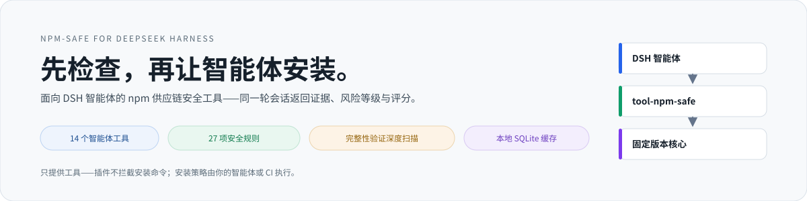
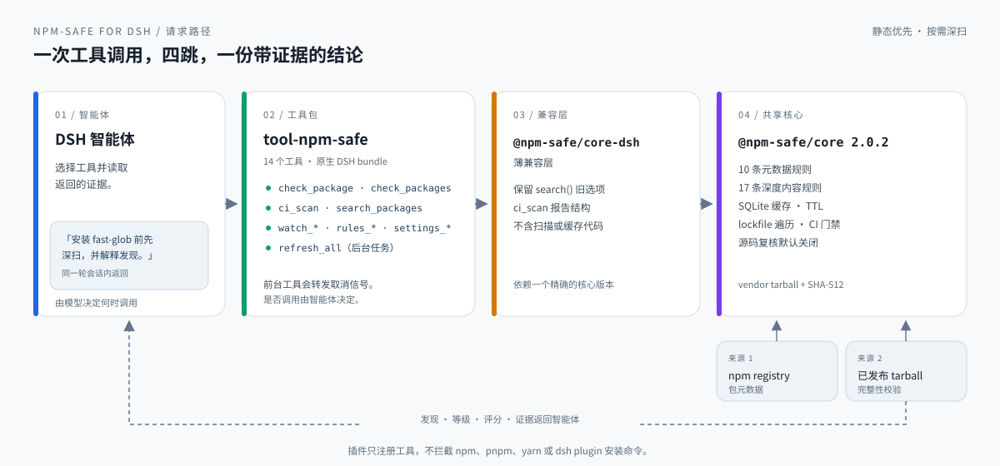
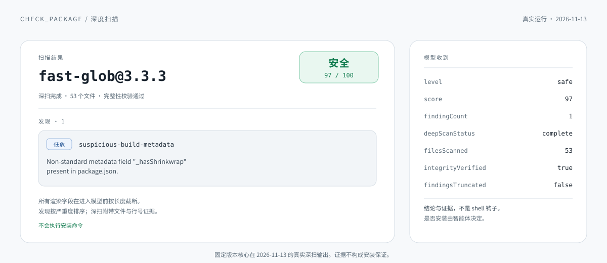

<div align="center">

<picture>
  <source media="(prefers-color-scheme: dark)" srcset="docs/assets/dsh-banner-zh-dark.svg">
  
</picture>

# npm-safe for DeepSeek Harness

**先检查，再让智能体安装。** 面向
[DeepSeek Harness](https://github.com/deepseek-ai/deepseek-harness) 智能体的
npm 供应链安全工具。

[](https://www.npmjs.com/package/@npm-safe/dsh-tool-npm-safe)
[](https://www.npmjs.com/package/@npm-safe/dsh-tool-npm-safe)
[](https://github.com/nisconder/npm-safe-forDSH/actions/workflows/ci.yml)
[](LICENSE)
[](https://nodejs.org)
[](https://github.com/topics/dsh-plugin)
[](https://www.dsh.so/artifact/npm-safe-fordsh/?ref=badge)

[安装](#30-秒安装) · [功能特性](#功能特性) · [安全模型](#安全模型) · [工具目录](#14-个智能体工具) · [文档](#文档) · [English](README.md)

</div>

---

`npm-safe-forDSH` 让智能体在安装之前检查 npm 包元数据和已发布 tarball，并在同一段
会话里返回证据、风险等级和可解释的 0–100 评分。检测通过固定版本的
[`@npm-safe/core`](https://github.com/nisconder/npm-safe) 扫描器在本地完成——无需账号、
无托管后端，默认不会把包源码发送给外部 LLM。

插件提供智能体可调用的检查工具，不会统一拦截 shell 命令，也不会自动阻止
所有 npm、pnpm、yarn 或 DSH 插件安装。请在智能体工作流中要求先检查将要安装的
精确版本，并由宿主或 CI 强制执行安装策略。`ci_scan` 的失败结果需要调用方处理。

> 插件固定使用 **@npm-safe/core 2.0.2**：完整扫描含 High 发现时等级至少为
> `suspicious`；可选的 LLM **源码复核**使用独立的默认关闭开关。固定发行版的
> 更新与验证方式见[共享核心工作流](vendor/README.md)。

## 为什么选择 npm-safe-forDSH？

`npm audit` 擅长发现已知依赖版本的已公开漏洞；npm-safe-forDSH 与之互补，
在安装决策之前为智能体提供**供应链攻击信号**：

- **本地优先。** 静态分析与缓存留在你的机器上，无需账号、无托管后端。
- **受限且惰性。** 深度扫描在严格字节预算内于内存中解析 tarball——绝不解压、绝不执行。
- **给证据，不给判决。** 发现附带严重性、规则、文件/行号位置与建议，智能体可以逐项解释。
- **可解释。** 10 条元数据规则 + 17 条深度扫描规则，全部可通过工具与持久化设置配置。

| 场景 | 对智能体说 | 得到什么 |
|---|---|---|
| 选包前检查 | `使用 check_package 检查 lodash` | 发现项、风险等级、安全评分 |
| 校验发布内容 | `安装 fast-glob 前先做深度扫描` | 完整性验证后的 tarball 检查 |
| 保护项目 | `使用 ci_scan 扫描依赖` | 依赖门禁，列出未通过的包 |
| 对比候选 | `使用 check_packages 检查 lodash、express、axios` | 每个包的排序证据 |
| 跟踪依赖 | `把 axios 加入监视列表` | 持久监视列表 + 后台刷新 |

<picture>
  <source media="(prefers-color-scheme: dark)" srcset="docs/assets/dsh-architecture.zh.svg">
  
</picture>

<sub>智能体选择工具，兼容层转发到固定版本核心，证据在同一轮会话返回；插件不会拦截安装命令。</sub>

> 如果它让你的智能体工作流更安全，请为仓库点一个 **Star**。这会帮助其他 DSH
> 用户发现这个独立安全工具。

## 30 秒安装

需要 Node.js 24.9+，以及已配置模型提供方的 DSH profile。

```bash
dsh plugin --profile tui add @npm-safe/dsh-tool-npm-safe --allow-build=better-sqlite3
dsh --profile tui
```

安装后请重启正在运行的 profile，然后直接提问：

```text
安装 fast-glob 前先做深度扫描，并解释每一项发现。
```

只做快速元数据检查：

```text
使用 check_package 检查 lodash。
```

插件已声明为原生 DSH bundle，因此官方 `dsh plugin` 命令会同时安装包并启用
`cordis.patch.yml` 层。`--allow-build=better-sqlite3` 只允许本地缓存所用的 SQLite
驱动执行构建脚本，pnpm 仍会拦截其他依赖的安装脚本。只有选择 DeepSeek 作为
提供方时才需要 DeepSeek API Key。

## 功能特性

### 深度扫描

元数据扫描速度快，因此保持为默认模式。设置 `deep: true` 后，插件会从所配置
注册表下载所选版本的 tarball，存在 npm 完整性元数据时先行校验，并完全在内存中
按严格边界检查源码。高置信度发现附带文件路径与行号。扫描器绝不解压包文件、
绝不执行包代码。

| 信号 | 元数据扫描 | 深度扫描 |
|---|:---:|:---:|
| 可疑生命周期脚本和安装钩子 | ✅ | ✅ |
| 拼写仿冒、废弃包和高风险维护者 | ✅ | ✅ |
| 非标准 registry 和远程二进制文件 | ✅ | ✅ |
| Tarball 完整性不匹配和危险归档路径 | — | ✅ |
| 混淆代码、嵌入密钥、Shell/网络执行 | — | ✅ |
| 原生二进制、WebAssembly、超限或截断内容 | — | ✅ |

| 限额 | 数值 |
|---|---|
| 压缩归档 | 20 MiB |
| 解压归档 | 50 MiB |
| 归档条目 | 5,000 |
| 单文本文件 | 4 MiB |
| 检查文本总量 | 8 MiB |

tarball 地址与重定向必须保持在所配置注册表同源。触及限额会给出可见的部分结果，
而不是静默通过；不可用的深度扫描会如实报告，绝不标为 `safe`。

```text
package: fast-glob@3.3.3
level: safe
score: 97/100
integrity: verified
files scanned: 53
findings: 1 low, 0 medium, 0 high, 0 critical
```

<picture>
  <source media="(prefers-color-scheme: dark)" srcset="docs/assets/dsh-scan-output.zh.svg">
  
</picture>

<sub>固定版本核心在 2026-11-13 的真实深扫输出。发现与评分是证据，不构成安装保证。</sub>

### 14 个智能体工具

| 工具 | 用途 | 执行方式 |
|---|---|---|
| `check_package` | 检查单个包；可选 `version`、`forceRefresh`、`deep`；返回带规则与位置的排序发现 | 前台（转发取消信号） |
| `check_packages` | 限流批量检查；可选 `deep` | 前台（限流） |
| `search_packages` | 关键词搜索 npm registry | 前台 |
| `watch_add` / `watch_remove` / `watch_list` | 管理持久监视列表 | 前台 |
| `rules_list` / `rule_enable` / `rule_disable` | 查看并启停规则（持久化） | 前台 |
| `rule_set_severity` | 覆盖规则严重性（持久化） | 前台 |
| `settings_get` / `settings_set` | 读取或更新引擎设置（持久化） | 前台 |
| `ci_scan` | 在智能体工作目录中做依赖门禁扫描 | 前台（转发取消信号） |
| `refresh_all` | 刷新全部监视包 | 后台（`ctx.jobs.start`） |

所有渲染字段在进入模型前按长度截断——包名、消息、路径、代码片段与建议都有上限，
单个包无法耗尽上下文窗口。发现按严重性排序；前台工具转发取消信号，`refresh_all`
作为 DSH 后台任务运行并使用任务自有取消信号。

### CI 门禁

`ci_scan` 扫描智能体工作目录中的项目，并列出未通过的包及其发现：

```text
使用 ci_scan 扫描依赖，failLevel 设为 suspicious，lockfile 设为 true
```

| 参数 | 作用 |
|---|---|
| `failLevel` | 门禁失败等级：`safe`、`suspicious`、`dangerous`、`unknown`（默认 `dangerous`） |
| `lockfile` | 扫描锁文件全部依赖（含传递依赖），按精确锁定版本检查 |
| `prod` | 跳过 devDependencies |
| `deep` | 下载并检查每个已发布 tarball |

Critical 发现即使分数很高也一律阻断；未知包与不完整扫描失败关闭。锁文件遍历与
失败策略由共享引擎负责，兼容层只格式化报告。扫描失败是工具结果——需要你的
智能体或 CI 处理。

### 规则与配置

10 条元数据规则与 17 条深度内容规则，检测安装脚本、混淆、仿冒包名、密钥泄露、
不安全归档、可执行内容、进程/网络组合等。直接在会话中管理：

```text
使用 rules_list 查看全部规则
使用 rule_disable 停用 install-script
使用 rule_set_severity 把 typosquatting 设为 critical
```

覆盖配置持久化在 `~/.npm-safe/rules.json`，并按共享扫描器指纹使缓存评估失效。
共享核心启动时还会加载 `~/.npm-safe/rules/` 中的本地规则插件。用 `rules_list`
（或 `engine.listRules()`）查看固定发行版中实际生效的规则；完整规则参考见
[上游扫描器](https://github.com/nisconder/npm-safe/blob/main/packages/core/SCANNER_RULES.md)。

### 监视列表、批量与刷新

`check_packages` 批量检查多个包，由引擎的令牌桶限流器（5 令牌/秒、突发 10）
避免注册表限流。监视包持久化在本地 SQLite 数据库中；`refresh_all` 以 DSH
后台任务重新检查它们，长耗时刷新不会阻塞会话。

### LLM 源码复核

共享引擎的可选 LLM 分析与**源码复核**（2.0）默认关闭；未配置 API key 时静态
分析照常运行。当通过引擎的保存配置（`~/.npm-safe/llm.json`，提供方：OpenAI、
Gemini、Anthropic）启用源码复核后，其发现会并入 `check_package`、
`check_packages` 与 `ci_scan` 的排序证据。

模型结论永远不能消除静态告警或抬高静态分数。Critical 级源码复核发现无论
`failLevel` 如何都会令 CI 门禁失败。只有所配置的提供方会收到所选摘录；延迟与
模型费用会增加。行为与限制见
[上游源码复核文档](https://github.com/nisconder/npm-safe/blob/main/docs/source-review.md)。

## 安全模型

npm-safe-forDSH 是早期预警启发式工具，**不是安全认证**。默认扫描检查注册表
元数据、所选清单与 README；`deep: true` 另在严格资源限额内校验并启发式检查
随包 tarball。

| 等级 | 含义 |
|---|---|
| `safe` | 80–100 分，无 High/Critical 发现，扫描完整 |
| `suspicious` | 50–79 分，或完整扫描存在 High 发现 |
| `dangerous` | 存在 Critical 发现，或 < 50 分 |
| `unknown` | 扫描不完整且未确立危险 |

分数 = 100 减去严重性权重（Critical 25 · High 15 · Medium 8 · Low 3）。`safe`
报告仍可能包含 Medium/Low 发现；分数与等级都不是运行时安全的概率或保证。
误报与漏报均有可能。生产环境仍应人工复核高影响依赖、锁定版本，并对智能体
施加最小权限控制。

- 核心检测是确定性的、本地优先的；默认不会把包源码发送给外部 LLM。
- 深度扫描拒绝跨域 tarball，并限制归档大小、文件数、解压量、路径与文本扫描量。
- 查看完整的[扫描规则](packages/core/SCANNER_RULES.md)和[安全策略](SECURITY.md)。

## 架构

一次工具调用，四跳，一份带证据的结论。插件导入 `@npm-safe/core-dsh`——固定版本
`@npm-safe/core` 的薄子类；所有注册表请求、扫描、缓存读取、规则配置、限流与
刷新都在共享包中执行。

| 层 | 职责 |
|---|---|
| **DSH 智能体** | 选择工具、读取证据、决定是否安装。 |
| **tool-npm-safe** | 14 个工具、原生 DSH bundle、输出限长、取消信号转发。 |
| **@npm-safe/core-dsh** | 薄兼容层：仅保留 search 旧选项与 CI 报告结构。 |
| **@npm-safe/core 2.0.2** | 注册表客户端、27 规则扫描器、调度器、SQLite 存储。 |

### 关键设计决策

| 决策 | 理由 |
|---|---|
| 固定核心 tarball + SHA-512 | 发布前对精确字节做测试；扫描器源码只在上游维护。 |
| 薄兼容层，不复制扫描器 | 检测、缓存有效性与失败策略只有一个事实来源。 |
| 工具输出限长 | 包可控文本在进入模型前按长度截断。 |
| 单一共享等级策略 | 实时扫描、缓存报告与 CI 一致；LLM 不能抬高静态分数。 |
| 只做工具，不做 shell 钩子 | 安装策略由智能体或宿主执行；插件绝不拦截命令。 |

[完整架构 →](packages/core/ARCHITECTURE.md)

## 配置与数据

| 路径 | 用途 |
|---|---|
| `./npm-safe.db` | SQLite（相对 DSH 宿主工作目录）：缓存、监视列表、设置、检查历史 |
| `~/.npm-safe/rules.json` | 规则启用/严重性覆盖 |
| `~/.npm-safe/rules/` | 共享核心加载的本地规则插件 |
| `~/.npm-safe/llm.json` | LLM 提供方配置（源码复核默认关闭） |

环境变量：可选 LLM 分析使用 `OPENAI_API_KEY` / `GEMINI_API_KEY` /
`ANTHROPIC_API_KEY`。元数据缓存 TTL 为 1 小时；规则变化使缓存报告失效。

## 直接使用引擎

```bash
pnpm add @npm-safe/core-dsh
```

```ts
import { NpmSafeEngine } from "@npm-safe/core-dsh";

const engine = new NpmSafeEngine();
const report = await engine.checkPackage("lodash", { version: "4.17.21", deep: true });
console.log(report.latestVersion, report.security.overallLevel, report.security.overallScore);
await engine.close();
```

## 从源码开发

要求 Node.js 24.9+ 与 Corepack。

```bash
git clone https://github.com/nisconder/npm-safe-forDSH.git
cd npm-safe-forDSH
corepack enable
corepack prepare pnpm@11.7.0 --activate
pnpm install
pnpm run build
pnpm run typecheck
pnpm run test
```

仓库通过工作区 override 将 `@npm-safe/core@2.0.2` 的发行 tarball 固定在
`vendor/`。扫描器源码只在 [`nisconder/npm-safe`](https://github.com/nisconder/npm-safe)
维护；这里的 `packages/core` 是兼容薄层，不复制扫描、缓存或注册表实现。
可复现的 `--core-tarball` 更新流程与发布顺序见[共享核心工作流](vendor/README.md)。

真实 npm registry 冒烟测试：

```bash
node scripts/smoke.mjs lodash
node scripts/smoke-facade.mjs
```

工作区包含 [`@npm-safe/core-dsh`](packages/core) 和
[`@npm-safe/dsh-tool-npm-safe`](packages/tool-npm-safe) bundle。DSH peer 包与
`0.2.2-rc.3` 版本族对齐，bundle 声明 `engines.dsh` 为
`>=0.2.2-rc.3 <0.3.0`；DeepSeek Harness 仍处于开发者预览阶段，升级时必须让
peer 与 `engines.dsh` 保持同步。

## 文档

| 主题 | 链接 |
|---|---|
| 插件包与示例 | [packages/tool-npm-safe/README.md](packages/tool-npm-safe/README.md) |
| 引擎 API | [packages/core/API.md](packages/core/API.md) |
| 架构 | [packages/core/ARCHITECTURE.md](packages/core/ARCHITECTURE.md) |
| 扫描规则 | [packages/core/SCANNER_RULES.md](packages/core/SCANNER_RULES.md) |
| 共享核心发布流程 | [vendor/README.md](vendor/README.md) |
| 贡献指南 | [CONTRIBUTING.md](CONTRIBUTING.md) |
| 安全策略 | [SECURITY.md](SECURITY.md) |
| 上游扫描器 | [nisconder/npm-safe](https://github.com/nisconder/npm-safe) |

本项目将 [`nisconder/npm-safe`](https://github.com/nisconder/npm-safe) 引擎适配到
DeepSeek Harness。它是独立社区项目，与 DeepSeek 没有关联，也未获得其官方背书。

## 许可证

[Apache-2.0](LICENSE) — Copyright 2026 Nisconder, InfiniteScope, Escap1ng, StoryBegins.
